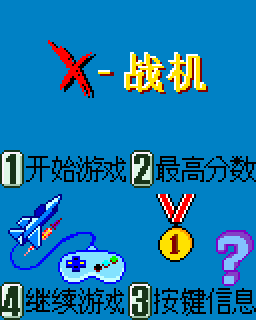
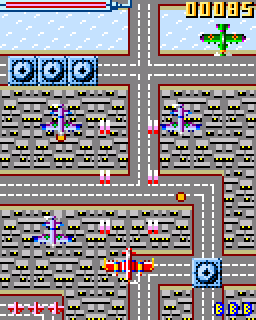
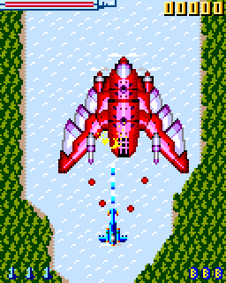
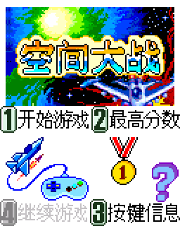
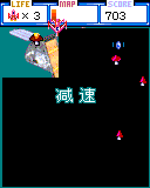
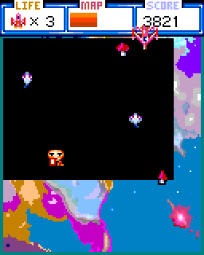
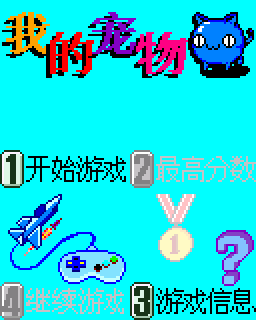
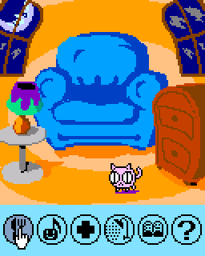
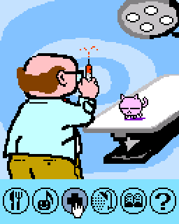
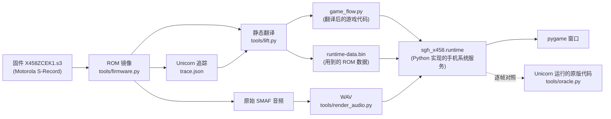

# SGH-X458 游戏复刻


把三星 Anycall SGH-X458 手机固件里的三款内置游戏，逐条指令翻译成 Python，在电脑上原汁原味地重玩。

本项目**不是模拟器**，不在电脑上运行手机的 ARM 代码。游戏逻辑由工具从固件的 Thumb 机器码静态翻译成 Python；画面和音频直接从固件提取。复刻结果用 [Unicorn](https://www.unicorn-engine.org/) 运行原版 ARM 代码逐帧对照：在测试覆盖的场景中，画面、游戏状态、定时器、音频请求和存档字节都与原版一致。

## 目录

- [游戏截图](#游戏截图)
- [功能特性](#功能特性)
- [部署与运行](#部署与运行)
- [使用说明](#使用说明)
- [逆向与复刻原理](#逆向与复刻原理)
- [目录与文件说明](#目录与文件说明)
- [与原版游戏的不同](#与原版游戏的不同)
- [开发指南](#开发指南)
- [常见问题](#常见问题)
- [已知限制与待办](#已知限制与待办)
- [参与贡献](#参与贡献)
- [许可与声明](#许可与声明)
- [致谢](#致谢)

## 游戏截图

以下截图都是游戏自己渲染的画面，放大 2 倍显示，可用 `python -m tools.screenshots` 重新生成。

**X-战机**：纵版射击，三个关卡，各有 Boss。

| 标题菜单 | 第 2 关战斗 | 第 1 关 Boss |
|:---:|:---:|:---:|
|  |  |  |

**空间大战**：在黑色星空中拉线圈地，揭开隐藏的图片，共十关。

| 标题菜单 | 第 1 关圈地，揭出「减速」道具 | 第 5 关圈出大片区域 |
|:---:|:---:|:---:|
|  |  |  |

**我的宠物**：电子宠物，饥饿、心情、健康等状态随真实时间变化。

| 标题菜单 | 宠物房间 | 带宠物看医生 |
|:---:|:---:|:---:|
|  |  |  |

## 功能特性

- **忠实复刻**：游戏流程、关卡、敌人、计分、排行榜和存档格式都来自固件本身，保留原版的定时节奏。
- **三种语言**：支持简体中文（默认）、繁体中文和英文，与手机原版一致。
- **图形启动器**：选择游戏、窗口尺寸（128×160 至 400×500）和音量，并设置各游戏的练习选项。
- **练习功能**：两款战斗游戏可跳关、开无敌、调整初始装备；三款游戏都可以 0.5×–2× 倍速运行。
- **关窗续玩**：两款战斗游戏关闭窗口时保存进度，下次打开后在菜单按 4 继续。
- **键盘友好**：方向键和 WASD 都能用；排行榜录入名字时可以直接打字，不用手机的九宫格多次按键选字。
- **单文件 EXE**：可打包成一个 EXE，复制到其他 Windows 电脑上即可运行。
- **可验证**：附带完整的离线工具链，可以从固件重新生成全部翻译代码和素材，并与原版代码逐帧对照。

## 部署与运行

### 系统要求

- Windows 10 或 11（64 位）。项目主要在 Windows 上开发和测试。
- 从源码运行需要 Python 3.12。

### 方式一：从源码运行

克隆仓库后，在项目根目录运行：

```powershell
python -m venv .venv
.\.venv\Scripts\python.exe -m pip install -e .
```

然后双击 `run.bat` 打开启动器，选择游戏后点「启动游戏」。

`run.bat` 会自动使用 `.venv`，并把 `src/` 加入模块搜索路径，所以即使不执行 `pip install -e .`，只要装好了 `pygame-ce` 也能启动。

也可以在命令行运行：

```powershell
.\.venv\Scripts\python.exe -m sgh_x458             # 启动器
.\.venv\Scripts\python.exe -m sgh_x458.x_fighter   # 直接进入 X-战机
.\.venv\Scripts\python.exe -m sgh_x458.spacewar    # 直接进入空间大战
.\.venv\Scripts\python.exe -m sgh_x458.mypet       # 直接进入我的宠物
```

安装后还可以直接用命令 `sgh-x458` 打开启动器。

### 方式二：构建 Windows 单文件 EXE

```powershell
.\.venv\Scripts\python.exe -m pip install -e ".[build]"
.\.venv\Scripts\python.exe -m PyInstaller --noconfirm --workpath .local\package-build SGH-X458-Games.spec
```

生成的 `dist/SGH-X458-Games.exe` 约 21 MB，内含 Python、三款游戏和全部素材，复制到其他 64 位 Windows 电脑上双击即可运行。EXE 的设置和存档写在 `%LOCALAPPDATA%\SGH-X458-Games`。

## 使用说明

### 启动器

启动器上半部分是当前游戏的选项，下半部分是窗口、声音设置和按键说明。设置会在启动游戏时保存，下次打开自动恢复；「恢复默认」可以重置当前选项。

| 游戏 | 可调选项 |
|---|---|
| 共用 | 窗口尺寸 128×160／200×250／300×375／400×500（最近邻缩放），音量 0–100%，静音 |
| X-战机 | 进入场景（标题菜单／战斗进度／Boss 战）、关卡 1–3、战斗进度 %、战机（速度+／攻击+／防御+）、无敌、武器强化、初始护盾、炸弹数量 0–10、倍速 |
| 空间大战 | 进入场景（标题菜单／直接进入关卡）、起始关卡 1–10、初始后备机 0–100、初始道具（加速／减速／奖命）、无敌、倍速 |
| 我的宠物 | 倍速 |

两款战斗游戏只要改动过上述任一选项（倍速也算），成绩就记入单独的练习排行榜，不影响正式排行榜。

### 操作

| 场景 | X-战机 | 空间大战 | 我的宠物 |
|---|---|---|---|
| 标题菜单 | Enter／1 开始，2 最高分，3 帮助，4 继续 | 同左 | Enter／1 开始，3 帮助，4 继续存档 |
| 移动 | 方向键／WASD | 方向键／WASD，点按一次后持续移动 | ←／→ 或 A／D 选图标 |
| 动作 | 普通子弹自动发射；Z／空格 导弹，X 核弹 | 空格／5 停止移动 | Enter／空格 确认 |
| 暂停与返回 | Esc／Backspace | Esc 暂停，Enter／4 恢复 | Esc 返回上一层 |
| 成绩录入 | 直接键入字母、数字、空格；Backspace 删除，Enter 保存 | 同左 | — |

手机原有的数字键操作同样可用，主键盘和小键盘都行。空间大战的续关提示按 7 续关、9 结束。各游戏的完整操作见 [docs/](docs/) 中的文档。

### 命令行参数

三款游戏共用以下参数：

| 参数 | 说明 |
|---|---|
| `--size {128x160,200x250,300x375,400x500}` | 窗口尺寸，默认 400x500 |
| `--volume 0-100`、`--mute` | 音量（默认 50）与静音 |
| `--language {0,1,2}` | 0 英文，1 简体中文（默认），2 繁体中文 |
| `--speed {0.5,0.75,1,1.5,2}` | 倍速，默认 1 |

各游戏的专属参数（用 `--help` 查看）：

| 游戏 | 参数 |
|---|---|
| X-战机 | `--scene {menu,select,stage,battle}`、`--stage 1-3`、`--aircraft 1-3`、`--progress 0-100`、`--invincible`、`--upgraded`、`--shield {off,full}`、`--bombs 0-10`、`--manual-fire`（关闭自动射击，按住 J 开火） |
| 空间大战 | `--scene {menu,stage}`、`--stage 1-10`、`--lives 0-100`、`--start-item {none,boost,slow,life}`、`--invincible` |

### 存档

| 文件 | 内容 |
|---|---|
| `X-Fighter/scores.bin`、`SpaceWar/scores.bin` | 正式排行榜 |
| `X-Fighter/practice-scores.bin`、`SpaceWar/practice-scores.bin` | 练习排行榜 |
| `X-Fighter/resume.bin`、`SpaceWar/resume.bin`（及 `practice-` 前缀版本） | 关窗时保存的进度 |
| `MyPet/save.bin` | 宠物存档 |
| `launcher.json` | 启动器设置 |

从源码运行时这些文件在项目根目录的 `.local/` 下，EXE 版在 `%LOCALAPPDATA%\SGH-X458-Games` 下。排行榜和宠物存档使用固件原本的 76 字节记录格式。删除对应文件即可重置。

## 逆向与复刻原理

### 整体流程



### 1. 读取固件

固件 `firmware/X458ZCEK1.s3` 是 Motorola S-Record 文本格式（约 85 万行）。`tools/firmware.py` 校验文件的 SHA-256 和每行的校验和，再按行中的装载地址拼出 14 MB 的 ROM 镜像，之后所有地址都指这个镜像中的位置。

### 2. 找到游戏

ROM `0x5995B0` 处有一张游戏注册表，每款游戏一条 28 字节的记录，记有名字、回调函数地址和画面尺寸。三款游戏的回调入口分别是 `0x235A34`、`0x2379DC` 和 `0x238022`。手机系统通过一个共用调度器（`0x20D7AC`）调用这些回调：打开菜单、定时更新、按键、退出都是不同的事件编号。

游戏需要的系统功能，比如提交画面、播放声音、注册定时器、读写存档，都是对固件里固定地址的调用。复刻只要在 Python 里实现这十来个系统服务，游戏代码就可以原样运行。

### 3. 追踪

用 [Unicorn](https://www.unicorn-engine.org/) CPU 模拟器加载 ROM，从调度器进入游戏，按脚本操作菜单、帮助、开局、移动、死亡、通关和成绩录入等场景，记下执行过的代码块和读过的数据地址，保存为 `tools/<game>/trace.json`。

### 4. 静态翻译

`tools/lift.py` 是一个 Thumb 指令翻译器。它从追踪到的入口出发，沿着所有能静态确定的跳转把代码走完，把每个基本块翻译成一个 Python 函数：

- 16 个寄存器是列表 `r[0..15]`，条件标志 N、Z、C、V 由 `runtime/word_ops.py` 按 32 位运算规则更新；
- 内存读写变成 `rd()`、`wr()` 调用；
- 每个函数返回下一个要执行的地址。

例如共用菜单里的这几条指令：

```text
20D30A  ldr  r0, [r7, #0x2c]      ; 读取当前语言
20D30C  cmp  r0, #0
20D30E  bne  #0x20d31c
20D310  movs r2, #0x9f            ; y = 159
20D312  movs r1, #0x7f            ; x = 127
20D314  ldr  r0, [pc, #0x114]     ; 位图地址
20D316  bl   #0x22b100            ; 调用位图绘制
```

被翻译成：

```python
def block_20D30A(p, r, rd, wr):
    r[0] = rd(p, r[7] + 44, 4)
    sub(p, r[0], 0, 1)
    if condition(p, 1):
        return 0x20D31C
    return 0x20D310

def block_20D310(p, r, rd, wr):
    r[2] = nz(p, 159)
    r[1] = nz(p, 127)
    r[0] = 0x5874CE
    r[14] = 0x20D31B
    return 0x22B100
```

三款游戏分别翻译出 3748、2170 和 2111 个代码块，生成的 `game_flow.py` 共约 7 万行。代码保留了固件地址，方便对照反汇编逐段核对。

翻译器同时把游戏实际读过的 ROM 数据（图像、调色板、关卡表、字符串等）打包进 `runtime-data.bin`。运行时不需要固件文件。

### 5. 运行时

`src/sgh_x458/runtime/` 用一个循环执行翻译后的代码：取出当前地址，如果是 Python 实现的系统服务或规则就调用它，否则执行对应的代码块，直到函数返回。

| 系统服务 | 固件地址 | Python 实现 |
|---|---|---|
| 提交画面 | `0x22808E` | 把 128×160 的 RGB565 帧交给 pygame 显示 |
| 位图绘制 | `0x22B100`、`0x22B174` | 解码 1／2／4／8 位索引色位图并按调色板上色 |
| 播放／停止／暂停／恢复声音 | `0x2280D8` 等 | 单声道播放预先渲染好的 WAV |
| 注册／停止定时器 | `0x228174`、`0x2281F0` | 按固件公式 `(13 × 毫秒 + 59) ÷ 60` 换算成约 4.6 毫秒一档的系统刻度 |
| 读写存档 | `0x228224`、`0x2282C4` | 读写 76 字节存档文件 |
| 除法、内存复制等库函数 | `0x14B3A4` 等 | 等价的 Python 运算 |

游戏专属的改动通过按地址覆盖固件例程实现：

- **X-战机**：战斗中的移动、拾取、核弹、编队、坠机等规则在 `game_rules.py` 里重写成具名函数，便于阅读和修改，结果与原版逐帧一致。
- **我的宠物**：用到了 ARM 软件浮点库，`game.py` 用 IEEE-754 运算替代了这几个库函数。
- **空间大战**：跳关、初始道具、三位数后备机显示等练习功能，也是在对应地址上插入规则实现的。

### 6. 音频

游戏音乐和音效是 Yamaha SMAF（`.mmf`）格式，原样从 ROM 切出后，用 Yamaha MA-3 软件引擎离线渲染成 48 kHz 立体声 WAV，再按游戏请求的地址播放。

### 7. 验证

`tools/<game>/verify*.py` 让翻译版和 Unicorn 中运行的原版代码同时经历相同的按键和时间，逐帧比较：

| 游戏 | 对照范围 |
|---|---|
| X-战机 | 三种语言 2227 帧；三关打到 Boss 及计分流程 4726 帧；197 张位图和 15 段音频与 ROM 一致 |
| 空间大战 | 799 次画面提交，覆盖十关开局、全部道具、续关、暂停、成绩录入；105 张位图、9 段音频 |
| 我的宠物 | 269 帧，每帧比较除堆栈外的整块内存；217 张位图、9 段音频 |

对照项目包括 RGB565 画面、游戏状态、定时器队列、音频请求和存档字节。

如果运行时遇到没翻译到的代码或没打包的数据，程序会直接报错退出，不会悄悄算错。

更详细的地址表和逆向记录见 [docs/firmware.md](docs/firmware.md) 和各游戏文档。

## 目录与文件说明

```text
SGH-X458-Games/
├── pyproject.toml               依赖、命令入口和打包配置
├── run.bat                      双击打开启动器
├── SGH-X458-Games.spec          PyInstaller 单文件 EXE 构建配置
├── LICENSE                      MIT 许可证（仅限本项目原创部分）
├── firmware/
│   └── X458ZCEK1.s3             原始刷机镜像，离线工具的输入
├── src/sgh_x458/                游戏程序包
│   ├── __main__.py              python -m sgh_x458 的入口，也是 EXE 的入口
│   ├── launcher.py              Tk 图形启动器
│   ├── runtime/                 三款游戏共用的运行层
│   │   ├── session.py           系统服务：定时器、声音、存档、画面提交、调度器调用
│   │   ├── translated_runtime.py  执行翻译代码的循环、内存与 ROM 数据访问
│   │   ├── word_ops.py          32 位 ARM 运算与条件标志，64 位库函数
│   │   ├── bitmap_draw.py       固件位图解码与绘制
│   │   ├── desktop.py           pygame 窗口、声音、帧循环、存档文件、命令行公共参数
│   │   ├── keys.py              键盘到手机按键的映射
│   │   ├── score_editor.py      两款战斗游戏共用的成绩录入（直接打字）
│   │   └── resume.py            关窗续玩的进度快照
│   ├── x_fighter/               X-战机
│   │   ├── play.py              桌面入口：按键处理、主循环、命令行参数
│   │   ├── game.py              游戏类，接入共用运行层和本游戏的规则覆盖
│   │   ├── game_rules.py        用具名函数重写的战斗规则
│   │   ├── practice.py          跳到选机、关卡、战斗进度和 Boss 战
│   │   ├── audio_mix.py         按真机录音调整的音效滤波与音量
│   │   ├── layout.py            资源路径、ROM 区间、RAM 状态地址
│   │   ├── game_flow.py         从固件翻译的代码（生成物，勿手改）
│   │   └── assets/              runtime-data.bin、manifest.json、WAV、原始 MMF、playback.json
│   ├── spacewar/                空间大战（play.py、game.py、layout.py、game_flow.py、assets/）
│   └── mypet/                   我的宠物（同上）
├── tools/                       离线工具，需要固件和 Unicorn
│   ├── firmware.py              读取并校验 S-Record 固件，解析位图和 SMAF 记录
│   ├── lift.py                  Thumb → Python 静态翻译器
│   ├── oracle.py                在 Unicorn 中运行原版代码的对照器基类
│   ├── assets.py                位图、PNG 和 SMAF 导出
│   ├── render_audio.py          调用 MA-3 引擎把 SMAF 渲染成 WAV（需 32 位 Python）
│   ├── screenshots.py           生成 README 截图
│   ├── x_fighter/               lift.py（重新生成）、extract_assets.py（完整导出）、verify*.py、trace.json
│   ├── spacewar/                extract.py（重新生成）、oracle.py、verify.py、trace.json
│   └── mypet/                   extract.py、probe.py／trace.py（追踪）、oracle.py、verify.py、trace.json
└── docs/
    ├── firmware.md              固件格式、游戏注册表、系统服务地址和逆向方法
    ├── x_fighter.md             X-战机：资源、定时、音频和逆向记录
    ├── spacewar.md              空间大战：自定义开局、资源和验证范围
    ├── mypet.md                 我的宠物：操作、状态布局和验证范围
    └── images/                  README 截图
```

`.local/`（存档、设置和离线输出）、`.venv/`、`build/` 和 `dist/` 不入库。

## 与原版游戏的不同

以下差异都是有意为之的桌面适配或新增功能。

### 新增功能

- **图形启动器**：原版从手机的游戏菜单进入，这里改为一个统一的启动器。
- **窗口与倍速**：四档窗口尺寸、音量调节、0.5×–2× 倍速。
- **X-战机练习**：直接进入某关的指定进度或 Boss 战（Boss 入场音乐响起前 2 秒）、选择战机、无敌、开局武器强化、初始护盾和炸弹数量。初始装备只在本次启动后的第一场战斗生效。
- **空间大战练习**：直接从第 1–10 关开始，初始后备机最多 100 架，开局道具，无敌。原版的后备机数字只显示一位；后备机达到 10 架及以上时，桌面版显示完整的两到三位数。
- **练习排行榜**：使用练习选项时，成绩单独记入练习排行榜。
- **关窗续玩**：两款战斗游戏在关窗时保存完整进度快照，正式模式和练习模式分开保存。原版只保存排行榜。

### 操作适配

- **成绩录入**：直接用键盘输入字母、数字和空格，不再使用手机九宫格多次按键选字。
- **按键映射**：方向键、WASD、Enter、Esc、空格等映射到手机按键，原有数字键照常可用。
- **X-战机长按与连发**：长按移动键会在每次战斗更新时重复移动；导弹和核弹指令会排队，每次更新执行一个，不会被移动键覆盖。
- **X-战机手动射击**：命令行加 `--manual-fire` 时关闭自动射击，按住 J 开火；默认与原版一样自动射击。
- **输入法**：游戏窗口关闭了文字输入，中文输入法开启时 WASD 等按键也能用。

### 画面与声音

- **标题菜单配色**：数字按钮的颜色在桌面上重新着色；没有续玩进度时，X-战机的「4 继续游戏」显示为灰色。
- **X-战机音效**：按真机录音，对 5 段音效（中弹、两种爆炸、两种导弹发射）削减过重的低频，并统一降低音量。
- **X-战机激光坠机**：连续被 Boss 激光击中时，坠机音效间隔按真机录音设为 382 毫秒。这是唯一偏离固件定时的地方。
- **音频来源**：声音由 MA-3 软件引擎渲染，不是真机芯片的原声；只有一个声道，与原版一样新声音会打断旧声音。
- **颜色**：RGB565 按线性换算成 24 位颜色，没有模拟手机 LCD 的显示特性。

### 技术性适配

- **窗口卡顿保护**：每帧最多推进 100 毫秒，窗口卡住（例如拖动窗口）后不会一次补跑大量游戏更新。
- **实时时钟**：时钟读取电脑的本地时间，我的宠物据此计算状态变化，与手机读取系统时钟的方式相同。
- **空间大战计算上限**：圈出大面积区域时计算量很大，单次事件的执行上限从 50 万块提高到 1000 万块。

## 开发指南

### 安装开发依赖

```powershell
.\.venv\Scripts\python.exe -m pip install -e ".[tools]"
```

`[tools]` 会额外安装 Unicorn，用于追踪和对照。

### 修改玩法的方式

- **不要直接改 `game_flow.py`**：它是生成物，重新生成时会被覆盖。
- **想改某个固件例程的行为**：在对应游戏的 `game.py` 里向 `self.rules` 注册一个地址到 Python 函数的映射，函数返回下一个地址，返回 `None` 表示返回调用者。X-战机的战斗规则直接改 `game_rules.py`。
- **桌面相关的功能**：输入、显示、启动选项放在 `play.py` 或 `runtime/desktop.py`，不要混进游戏逻辑。

### 固件对照验证

```powershell
.\.venv\Scripts\python.exe -B -m tools.x_fighter.verify_source --compare-rom --all-stages
.\.venv\Scripts\python.exe -B -m tools.x_fighter.verify --all-stages
.\.venv\Scripts\python.exe -B -m tools.spacewar.verify
.\.venv\Scripts\python.exe -B -m tools.mypet.verify
```

修改 `runtime/`、`game.py` 或 `game_rules.py` 后请重新运行对应的验证。`tools.x_fighter.verify --all-stages` 要在原版代码里打完三个 Boss，约需 20 分钟；其余每条在 2 分钟以内。

### 重新生成翻译代码和素材

```powershell
.\.venv\Scripts\python.exe -B -m tools.x_fighter.lift
.\.venv\Scripts\python.exe -B -m tools.spacewar.extract
.\.venv\Scripts\python.exe -B -m tools.mypet.extract
```

这些命令根据 `tools/<game>/trace.json` 和固件重新生成 `game_flow.py` 和 `assets/`。在现有追踪数据下，结果与仓库中的文件逐字节相同。

- **我的宠物重新追踪**：运行 `python -m tools.mypet.trace`，完整运行约 9 分钟。
- **重新渲染 WAV**：需要 32 位 Windows Python 和 MA-3 引擎 DLL，见 [docs/x_fighter.md](docs/x_fighter.md)。
- **重新生成 README 截图**：运行 `python -m tools.screenshots`。

## 常见问题

**为什么不直接做模拟器？**

模拟器要模拟整台手机的 CPU、操作系统和硬件，而这三款游戏只依赖十来个系统服务。把游戏代码翻译成 Python，再用 Python 实现这些服务，运行时不需要固件，代码可以阅读、修改和调试，也更容易打包分发。

**能在 macOS 或 Linux 上运行吗？**

没有测试过。游戏代码本身不依赖 Windows，`python -m sgh_x458` 可能可以运行，但 `run.bat`、输入法处理和 EXE 打包都是为 Windows 准备的。

**游戏没有声音？**

检查启动器里是否勾选了静音、音量是否为 0。如果电脑没有可用的音频设备，游戏会在控制台提示 `Audio unavailable` 并继续无声运行。

**提示 `Unresolved game control flow` 或 `Missing extracted data`？**

说明游戏走到了追踪时没有覆盖的代码或数据，属于复刻遗漏。请在 Issue 中附上游戏、操作步骤和完整报错，以便补充追踪。

**为什么声音和我记忆中的真机不一样？**

音频是用 Yamaha MA-3 软件引擎重新渲染的，不是从真机录制，音色会与真机扬声器有差异。

## 已知限制与待办

- **尚待真机实测**：屏幕颜色、扬声器音色、空间大战十关自然通关、我的宠物长期养成结果。
- **追踪覆盖有限**：翻译代码只覆盖追踪到的入口和所有静态可达的代码，经函数指针间接调用的路径如果没被追踪到，运行时会报错。
- **X-战机的手动射击**：只能通过命令行开启，启动器里没有这个选项。

## 参与贡献

欢迎提交 Issue 和 Pull Request。

- **报告问题**：请写明游戏、启动选项、操作步骤和报错信息。
- **提交代码前**：请运行受影响游戏的验证脚本，确认与原版的对照仍然通过。
- **生成物**：请通过 `tools/` 重新生成 `game_flow.py` 和 `assets/`，不要手动编辑。

## 许可与声明

本项目的原创代码和文档以 [MIT 许可证](LICENSE) 发布。

`firmware/` 中的三星 SGH-X458 固件，以及从中提取或翻译出的游戏图像、音频、文字和程序逻辑（包括 `src/sgh_x458/*/assets/`、生成的 `game_flow.py` 和 `docs/images/` 中的截图），版权归三星电子及原游戏开发者所有，不在 MIT 许可范围内。

本项目仅用于技术研究和老游戏保存，与三星电子无关，也未获其授权。如果权利人认为本项目有不妥之处，请通过 Issue 联系，我们会及时处理。

## 致谢

- [Unicorn Engine](https://www.unicorn-engine.org/)：运行原版 ARM 代码做追踪和对照。
- [pygame-ce](https://pyga.me/)：显示与音频。
- [libsmaf](https://github.com/denjhang/libsmaf) 收录的 Yamaha MA-3 渲染器：离线把 SMAF 渲染成 WAV。
- [PyInstaller](https://pyinstaller.org/)：打包单文件 EXE。
