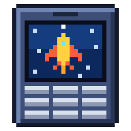

<p align="center"></p>

# SGH-X458 游戏复刻


把三星 Anycall SGH-X458 手机里的三款内置游戏《X-战机》《空间大战》《我的宠物》，从固件翻译成 Python，在电脑上重玩。

## 游戏截图

| X-战机 | 第 2 关战斗 | 第 1 关 Boss |
|:---:|:---:|:---:|
|  |  |  |

| 空间大战 | 第 1 关 | 第 5 关 |
|:---:|:---:|:---:|
|  |  |  |

| 我的宠物 | 宠物房间 | 带宠物看医生 |
|:---:|:---:|:---:|
|  |  |  |

## 部署与运行

需要 Windows 10/11 和 [Python 3.12](https://www.python.org/downloads/)。以下命令在 PowerShell 中运行。

**1. 获取代码**

```powershell
git clone https://github.com/hb2cpc/SGH-X458-Games.git
cd SGH-X458-Games
```

**2. 创建虚拟环境**

```powershell
python -m venv .venv
```

**3. 安装依赖**

依赖写在 `pyproject.toml` 里（作用相当于 `requirements.txt`），运行游戏只需要 `pygame-ce`：

```powershell
.\.venv\Scripts\python.exe -m pip install -e .
```

**4. 运行**

双击 `run.bat` 打开启动器，或在命令行运行：

```powershell
.\.venv\Scripts\python.exe -m sgh_x458             # 启动器
.\.venv\Scripts\python.exe -m sgh_x458.x_fighter   # 直接进入 X-战机（另有 spacewar、mypet），加 --help 查看参数
```

存档和设置保存在项目根目录的 `.local/` 下。

**5. 打包成单文件 EXE（可选）**

需要先安装 [ffmpeg](https://ffmpeg.org/)（用于把音频压缩成 OGG）并加入 PATH：

```powershell
.\.venv\Scripts\python.exe -m pip install -e ".[build]"
.\.venv\Scripts\python.exe -m PyInstaller --noconfirm --workpath .local\package-build SGH-X458-Games.spec
```

生成的 `dist\SGH-X458-Games.exe` 约 11 MB，复制到没有 Python 的 Windows 10/11 电脑上双击即可运行，存档写在 `%LOCALAPPDATA%\SGH-X458-Games`。

## 逆向流程

1. 用 Unicorn 运行固件里的游戏代码，记录执行过的代码和读过的数据。
2. 把这些 ARM Thumb 指令逐条翻译成 Python（`game_flow.py`），用到的图像、音频和数据表一并提取出来。
3. 用 Python 实现游戏依赖的手机系统服务：画面、声音、定时器、存档。
4. 让翻译版和原版代码执行同样的操作，逐帧比较画面、状态和存档，确认一致。

运行时不需要固件。固件格式和地址细节见 [docs/firmware.md](docs/firmware.md)。

## 与原版游戏的不同

- 新增启动器、窗口缩放、倍速，以及两款战斗游戏的跳关、无敌、初始装备等练习选项（成绩记入单独的练习排行榜）。
- 两款战斗游戏关窗时自动保存进度，下次在菜单按 4 继续；中途更改启动器设置也能继续。
- 键盘操作：方向键／WASD 移动，录入成绩时直接打字，不用九宫格。
- X-战机的部分音效按真机录音调整了音量和低频。
- 声音由 Yamaha MA-3 软件引擎渲染，与真机扬声器的音色会有差异。

## 许可与声明

代码以 [MIT 许可证](LICENSE) 发布。固件、游戏素材和截图版权归三星电子及原游戏开发者所有，不在 MIT 许可范围内。本项目仅用于技术研究和老游戏保存，与三星电子无关。

## 致谢

[Unicorn Engine](https://www.unicorn-engine.org/)、[pygame-ce](https://pyga.me/)、[libsmaf](https://github.com/denjhang/libsmaf)（Yamaha MA-3 渲染器）、[PyInstaller](https://pyinstaller.org/)。
